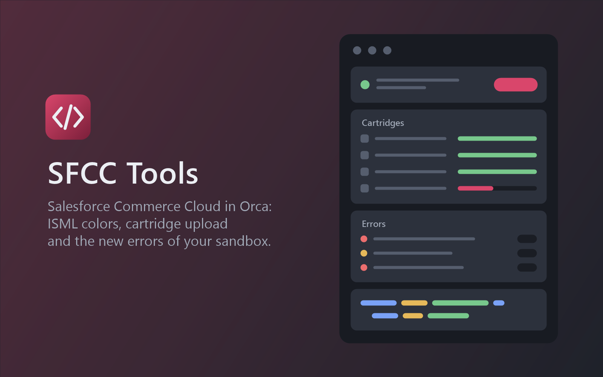

<div align="center">

#  SFCC Tools for Orca

**Orca plugin for Salesforce Commerce Cloud work: ISML syntax, cartridge upload and sandbox errors.**

[](https://github.com/stablyai/orca)
[](#-how-it-works)
[](https://developer.salesforce.com/docs/commerce/b2c-commerce/overview)



</div>

---

## ✨ What this is

What it takes to work on a Salesforce Commerce Cloud project from
[Orca](https://github.com/stablyai/orca), in one plugin. Today it holds the base: an **SFCC**
panel that shows whether `b2c` is installed and, for each environment of the workspace's
`dw.json`, whether it is ready, incomplete or not configured. The pieces in the table are added
one at a time.

| | Piece | What it does |
|---|---|---|
| 🧩 | **ISML** | Colours `.isml` templates in Orca's editor: HTML, `<is…>` tags, `${…}` expressions, `<isscript>` and both kinds of comment |
| ⬆️ | **Upload** | Deploys the workspace you pick to a code version of its own, activates it and uploads every change after that; removing the workspace deletes its version |
| 🚦 | **Sandbox** | Started, stopped or busy, with start and stop, and which workspace uploads to which code version, in the status bar |
| 🪵 | **Errors** | The new errors of each environment's log, one row per error however often it repeats, until marked as seen; the sandbox's count in the status bar |
| 🐞 | **Debugger** | Breakpoints on the sandbox, and the threads, call stack and variables of a request halted on one, with continue and step |

---

## 🧭 How it works

- **On the official CLI.** Upload, logs, the sandbox and debugging go through `b2c`,
  Salesforce's CLI.
  It is the only thing the plugin needs installed: it ships no binaries of its own.
- **Four environments.** The sandbox reads the plain keys of `dw.json`; development, staging
  and production read the same keys with a suffix (`-dev`, `-stg`, `-prd`, set in Settings).
  Only the sandbox can be uploaded to or debugged; the other three are read for logs only.
- **One workspace uploads.** With several worktrees and one sandbox, the workspace that
  uploads is picked by hand; switching tabs never changes what the sandbox runs.
- **No build.** Orca loads the `.ts` and `.tsx` files as written; `node_modules` only holds
  the development typings.

---

## 🔐 What is public

This repo is **public** and holds only the plugin: nothing of any project it is used on.
No hosts, sandbox names, credentials or customer data are written here. The plugin reads the
workspace's `dw.json` for one purpose: to hand `b2c` the host and credentials of each
environment, in the environment of the process it starts. They are never stored, logged,
shown in the panel or passed as arguments.

---

## 🚀 Getting started

Install [`b2c`](https://developer.salesforce.com/docs/commerce/b2c-commerce/overview), then:

```bash
npm install
npm run typecheck
npm test
```

---

<div align="center">
<sub><a href="https://moilolon.com">moilolon.com</a> · <a href="https://github.com/moilolon">@moilolon</a></sub>
</div>
