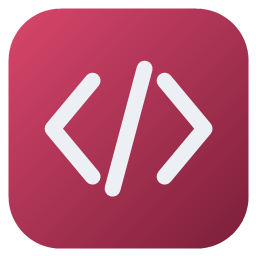

<div align="center">

#  SFCC Tools for Orca

**Orca plugin for Salesforce Commerce Cloud work: ISML syntax, cartridge upload and sandbox errors.**

[](https://github.com/stablyai/orca)
[](#-how-it-works)
[](https://developer.salesforce.com/docs/commerce/b2c-commerce/overview)


</div>

---

## ✨ What this is

What it takes to work on a Salesforce Commerce Cloud project from
[Orca](https://github.com/stablyai/orca), in one plugin. An **SFCC** panel holds a view per
piece, a line with whether each environment of the workspace's `dw.json` is ready, and a setup
view that says what is missing and how to fix it. The pieces in the table are added one at a
time.

| | Piece | What it does |
|---|---|---|
| 🧩 | **ISML** | Colours `.isml` templates in Orca's editor: HTML, `<is…>` tags, `${…}` expressions, `<isscript>` and both kinds of comment |
| ⬆️ | **Upload** | Deploys the workspace you pick to a code version of its own, activates it and uploads every change after that; removing the workspace deletes its version |
| 🚦 | **Sandbox** | Started, stopped or busy, with start and stop, and which workspace uploads to which code version, in the status bar |
| 🪵 | **Errors** | The new errors of each environment's log, one row per error however often it repeats, until marked as seen; each with its detail, its stack trace and a breakpoint on any of its frames; the sandbox's count in the status bar |
| 🐞 | **Debugger** | Breakpoints on the sandbox, set by clicking a line of a script, and the threads, call stack and variables of a request halted on one, with continue and step |
| 🔎 | **Problems** | Reads the workspace's cartridges and lists what would fail: custom attributes and site preferences the metadata lacks, templates and resource keys missing on a storefront, SFRA route chains the platform refuses, broken form definitions and `steptypes.json`; each opens at its line, and a save or an agent's edit that adds some is notified, never with what |
| ✏️ | **Editor** | An editor of its own for templates, scripts, bundles and site XML: opens `.isml` by default and the rest from the view toggle or `Alt+Shift+E`; every file the plugin opens goes to it. It completes tags, `dw.*` members, templates, resource keys and modules, explains what the pointer rests on, underlines the problems of the file as you type, and goes to a definition (`F12`) or the references (`Shift+F12`) on each storefront |

---

## 🧭 How it works

- **On the official CLI.** Upload, logs, the sandbox and debugging go through `b2c`,
  Salesforce's CLI.
  It is the only thing the plugin needs installed: it ships no binaries of its own.
- **Four environments.** The sandbox reads the plain keys of `dw.json`; development, staging
  and production read the same keys with a suffix (`-dev`, `-stg`, `-prd`, set in Settings).
  Only the sandbox can be uploaded to or debugged; the other three are read for logs only.
- **One workspace uploads.** With several worktrees and one sandbox, the workspace that
  uploads is picked by hand; switching tabs never changes what the sandbox runs.
- **No build.** Orca loads the `.ts` and `.tsx` files as written; `node_modules` only holds
  the development typings.

---

## 🔐 What is public

This repo is **public** and holds only the plugin: nothing of any project it is used on.
No hosts, sandbox names, credentials or customer data are written here. The plugin reads the
workspace's `dw.json` for one purpose: to hand `b2c` the host and credentials of each
environment, in the environment of the process it starts. They are never stored, logged,
shown in the panel or passed as arguments.

---

## 🚀 Getting started

Install [`b2c`](https://developer.salesforce.com/docs/commerce/b2c-commerce/overview), then:

```bash
npm install
npm run typecheck
npm test
```

---

## ☀️ Morning error report

The errors piece also runs outside Orca, for a bot that reports each morning. It reads each
environment's log through `b2c` and prints what is new since its last report and what is still
not marked as seen in the panel: signatures, counts and normalised messages with values masked,
never a raw entry, a host or a credential.

```bash
node bin/errors.ts --config-file <dw.json> --role sandbox --role production --json
```

It needs Node 22.18 or later and no build. It reads the panel's seen list and never writes it;
it keeps its own cursor beside it, in the plugin's data folder. It exits 1 when an environment
could not be read, and says which. The bot `sfcc-tools` runs it each weekday morning with the prompt in
[`docs/bot-prompt.md`](docs/bot-prompt.md) and leaves one short summary per environment in its
own chat.

---

<div align="center">
<sub><a href="https://moilolon.com">moilolon.com</a> · <a href="https://github.com/moilolon">@moilolon</a></sub>
</div>
