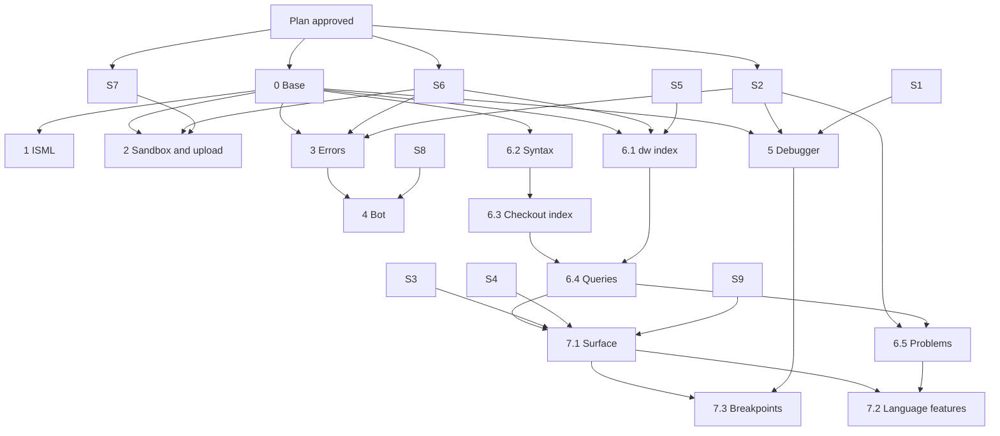

# Build plan

How the plugin gets built: what each phase delivers, what it leaves out, where its code lives,
what it promises the rest, how it is proven, and what has to be answered first. This file
describes the current plan only; when the plan changes, the text changes with it.

Status: **nothing is built yet.** No phase starts until this plan is approved.

## 1. Ground rules

1. Everything is written in this repository. No binaries and no code from other tool
   repositories.
2. Upload, logs, sandbox, debugging and API documentation go through the official `b2c` CLI.
   The plugin reads the workspace's `dw.json` for one purpose: to tell `b2c` which host and
   credentials each environment uses. One module reads it, and what it reads goes to `b2c` in
   the environment of the process it starts and nowhere else: it is never stored, logged,
   shown in a panel or sent anywhere.
3. The repository is public and holds nothing of any project it is used on: no hosts, sandbox
   names, credentials or customer data, in code, tests, fixtures, commits or pull requests.
   Every fixture is invented.
4. One plugin holds everything.
5. With several worktrees and one sandbox, the workspace that uploads is picked by hand and
   never follows the focused workspace. Each workspace has its own code version: activated when
   the workspace is picked, deleted when the workspace is removed.
6. The error diff is the plugin's own: a signature per error and a list of seen signatures per
   instance. Log content stays in the plugin's local storage.
7. The `dw.*` API index is committed on `main` with descriptions, generated from Salesforce's
   public Script API pages and refreshed weekly by a workflow that opens a pull request.
8. The template piece is called "ISML".
9. Git as `CLAUDE.md` says.

## 2. What the host allows

Facts taken from the plugin guide of the installed Orca; the design below is built on them.

- A plugin can contribute TextMate grammars, a Node worker (which can start processes), panels,
  status bar items, palette commands, settings, hooks (`editor.save.before`,
  `agent.tool.before/after`, `workspace.create.before/after`) and editors for a file type. It
  cannot contribute a language server, a native debugger, MCP servers or skills.
- Completion, hover, inline warnings and go to definition exist only inside an editor the
  plugin provides. That editor receives the text of the document, never its path, and it does
  not get the host's own syntax highlighting.
- `editor.save.before` fires on an explicit save from an editor tab only: not on autosave, not
  when an agent or another program writes the file. A hook has 2 s to answer.
- `editor.open` takes no line; `orca file open <path> --line --column --focus` does.
- The manifest is one JSON file with no includes and no unknown keys. Limits: 5 events, 8 hooks,
  8 status bar items, 64 settings, 256 commands. Settings are scalars (string, number, boolean)
  and belong to the plugin, not to a project.
- Loading a plugin that runs code needs the owner's approval, and so does every later change
  to its commands or access list. Unit tests, `plugin check` and `plugin validate` need none.
- A worker that owns a status bar item is kept running while the plugin is enabled. A worker
  restart drops its memory. It runs with a trimmed environment: no `APPDATA`, no Orca variables,
  and Orca's install folder as its working folder.
- Panels and editors have no network and import only `orca` and relative files; there is no
  bundler. The repository ships no `node_modules`.

## 3. Shape of the plugin

```
orca-plugin.json            generated from the fragments below, committed
scripts/                    development scripts (manifest merge, index generator)
src/manifest.base.json      identity, engine, access list
src/protocol.ts             shared types; imports every piece's protocol
src/core/                   what pieces share (see contracts)
src/worker/worker.ts        activate(): starts every piece in src/worker/pieces.ts
src/panel/panel.tsx         one sidebar panel, one section per piece (src/panel/sections.ts)
src/pieces/<piece>/
  manifest.json             the piece's commands, settings, hooks, events, status bar items
  protocol.ts               its requests and panel events
  worker.ts                 its worker half
  section.tsx               its panel section
  i18n.ts                   its English and Spanish texts
  *.test.ts                 tests beside each module
data/dw-api.json            the committed dw.* index
bin/                        the error diff as a command line
```

Pieces: `isml`, `sandbox`, `errors`, `debugger`, `engine`, `editor`.

**How phases stay out of each other's files.** Phase 0 creates every piece folder as an empty
stub and lists all of them in the two registries, so a later phase edits only files inside its
own folder. The one file every piece must change is the manifest, so it is generated:
`npm run manifest` merges `src/manifest.base.json` with every `src/pieces/*/manifest.json` into
`orca-plugin.json`, and a test fails when the committed file differs from the merge. Two phases
that land in a row conflict only in that generated file, and the conflict is resolved by running
the script again.

### Contracts every piece relies on (`src/core/`, delivered by phase 0)

| Module | Promise |
| --- | --- |
| `piece.ts` | `WorkerPiece { id; activate(ctx): Disposable \| void }` and `PanelSection { id; title; icon; render() }`. `ctx` carries the worker API, the `b2c` runner, settings, the store, the translator and a logger. |
| `b2c.ts` | The only place that starts `b2c`. `run(args, { role, cwd, signal, timeoutMs })` for one-shot commands (adds `--json`), `start(args, …)` for long-lived ones. It puts the role's host and credentials in the environment of the process (`SFCC_SERVER`, `SFCC_CLIENT_ID`, …), never in its arguments, tells `b2c` to load no configuration or `.env` file of its own, and pins the authentication methods. It starts no instance command for a role without credentials, sets the working folder itself, and takes only exit 0 as success. |
| `dw-config.ts` | The only place that reads `dw.json`: the one at the root of the workspace, or of the project's main checkout when a worktree has none; a setting can name another file. It answers `resolve(role)` with what `b2c.ts` needs and exposes nothing else: other modules learn only whether a role is configured. |
| `instances.ts` | Four roles: `sandbox`, `development`, `staging`, `production`. The sandbox uses the plain keys of `dw.json` (`hostname`, `client-id`, …); each other role uses the same keys with a suffix, a setting per role (`-dev`, `-stg` and `-prd` by default). A guard in the runner allows `code`, `debug` and sandbox commands on the `sandbox` role only; the other roles accept `logs` and nothing else. The guard is tested with a fake process. |
| `settings.ts` | Typed reads of the plugin's settings and change notifications. |
| `store.ts` | Typed access to the plugin's own storage, one namespace per piece. |
| `workspaces.ts` | The workspace list, and the workspace that uploads (read by `sandbox`, `debugger` and `engine`). |
| `i18n.ts` | `t(key, vars)` over per-piece tables; Spanish must have every English key (enforced by types). Worker error codes are worded by the panel. |
| `open-file.ts` | Opens a file of a workspace at a line, through `orca file open` with the workspace named explicitly. Lands with phase 3, the first to use it. |

Panel and worker talk only through requests and events declared in a piece's `protocol.ts`.
Request names are prefixed with the piece id (`sandbox.status`, `errors.list`, …).

## 4. How a phase is proven and merged

Each phase, or each numbered part of phases 6 and 7, is one pull request.

**Done** means all of:

1. `npm run typecheck`, `orca plugin test .`, `orca plugin check .` and `orca plugin validate .`
   pass, with their output in the pull request.
2. A capture from `orca plugin shot`, looked at by whoever took it.
3. From phase 2 on, a real run: against the sandbox where the phase talks to an instance,
   against a real checkout (read-only) where it only analyses code.
4. An independent reviewer with a clean context, given the diff and the acceptance criteria but
   not the implementer's conclusions, approved it.

There is no hosted CI for these checks: they need Orca, which the hosted runners do not have.
The evidence is the output recorded in the pull request, re-run by the reviewer.

**Roles.** One worker per task, each in its own child worktree, at most four at a time.
*Spike*: answers one open question with a minimal proof. *Implementer*: a phase or a part of
one, with its tests. *Reviewer*: finds faults and checks the diff against section 1. *Fixer*:
corrects what the reviewer or a failing check found. A worker that finds a problem outside its
task reports it and does not fix it; the coordinator opens a new task or asks.

**Live checks run one at a time.** Unit tests, `check`, `validate` and scenario captures run in
any worktree with no approval. Loading the plugin into Orca (needed for status bar, editor and
real-instance checks) needs the owner's approval and is done for one branch at a time, after the
review, by the coordinator's verifier task.

**What waits for the owner.**

- Approving the plugin in Orca: the access list is shown and nothing is approved on the
  owner's behalf. The access list is fixed in phase 0 (`storage:own`, `settings:own`,
  `workspace:read`, `workspace:write`, `notifications:show`); a phase that needs more stops.
- Any change to this file, any GitHub Actions workflow, creating the bot and its automation,
  and any repository setting.
- Activating a code version on the sandbox over the one in use.
- Publishing, tagging, or anything outside this repository.
- A spike that answers no: its phase stops and the alternative is proposed.

Everything else is merged by squash once the reviewer approved and every check passes.

**On real instances.** Tests on the sandbox use a code version of their own. Development,
staging and production are read for logs only: nothing is uploaded, activated or debugged
there, and the runner's guard enforces it. Hosts, credentials and log content never reach the
repository, a commit, a pull request or a capture attached to one: the panel shows roles, never
hosts.

## 5. Spikes

A spike delivers yes or no with the proof, and what changes if the answer is no. Spike code is
thrown away; an answered spike moves to the second table with what follows from it.

### Open

| Id | Question | Before | If no |
| --- | --- | --- | --- |
| S1 | Can a worker drive `b2c debug` (a DAP adapter) over stdio: initialize, attach, set a breakpoint, list threads? | 5 | Phase 5 stops; the transport the adapter does offer is proposed. |
| S3 | Can the open document be matched to its file from its text alone, including identical copies in several cartridges and unsaved edits, and with the path `editor.save.before` gives? | 7 | The editor is opened through a plugin command that records the path, and a tab opened another way asks which file it is. |
| S4 | Do `.js`, `.xml` and `.properties` open directly in a plugin editor, or only as an alternative view? | 7 | The editor is the default for `.isml` only; the other types are reached from the view toggle and their findings from the problems section. |
| S5 | Can hosted runners download the public Script API pages without being limited, is their structure stable enough to parse, and do their terms allow committing short descriptions? | 6.1 | The generator runs locally on demand and the workflow only reminds; or descriptions are left out of the committed index and read through `b2c docs` at run time. |
| S8 | Where can the seen list live so that the worker and a command line run outside Orca both read and write it, and how does a bot run call that command line? | 4 | The seen list moves to a file in the user's data folder that both open. |
| S9 | Is an editing surface written here (text layer, highlight layer, gutter, pop-ups) good enough inside an editor frame: typing latency on a 3,000-line file, undo, selection, composition input? | 7 | Phase 7 stops and vendoring an open-source editor component is put to the owner, since it bends rule 1. |

S1 runs against the sandbox. S3, S4 and S9 reuse the throwaway plugin the owner already
approved. S5 needs a workflow run, so it waits for the owner like any workflow.

### Answered

| Id | Question | Answer | What follows |
| --- | --- | --- | --- |
| S2 | Can a worker start `orca file open --line`? | Yes, with two conditions. The worker's environment has no `APPDATA` and its working folder is Orca's install folder, so the call needs `APPDATA` set and the workspace named with `--worktree path:<root>`. The executable is beside Orca's own and on the worker's `PATH`. | `core/open-file.ts` does exactly that. The cursor position is not echoed in the answer: it is confirmed by eye in the first live check that uses it (phase 3). |
| S6 | What does `b2c` print with `--json`, and does it authenticate from the environment alone? | Yes for all four roles, with no configuration file. With no credentials `b2c` does not fail: it opens a browser sign-in. Results are JSON on stdout only on success; `activate`, `delete` and `watch` print none; errors are JSON on stderr only sometimes; a failure can exit with any non-zero code. `code watch` streams one JSON event per line on stderr with `--jsonl`. A log entry is one error with its whole stack trace inside `message`, with no separate site or stack fields. `docs read` returns Markdown text and matches a wrong name to another class without failing. | The runner never starts an instance command without credentials and pins the authentication methods; it treats only exit 0 as success. Phase 2 reads `code watch` from stderr. Phase 3 parses site and stack out of the message and sorts entries itself. Phase 6.1 cannot take structure from `docs read`: it serves the long text of a hover, checked against the id asked. |
| S7 | Can the state of the sandbox be read from what `dw.json` holds? | Yes, through `b2c sandbox list`, matching the entry whose host equals the configured one. `b2c sandbox get` cannot be trusted: where a deleted sandbox shares its identifier with the live one, it returns the deleted record. | Phase 2 reads the state from the list. Start and stop are fired without waiting on `b2c` and followed on the list; whether they work with these credentials is checked once, supervised, in phase 2's live run. If the list is refused for lack of permission, the state shows as unknown. |

## 6. Phases

### Phase 0. Base

**Scope.** Manifest (generated), worker, one empty panel, the panel-worker contract, `src/core`,
tests, English and Spanish texts, settings (`b2cPath`, the configuration file, and the key
suffix of each role), the
stub of every piece and both registries, development scripts (`typecheck`, `test`, `check`,
`validate`, `manifest`), `tsconfig.json`, and `README.md` and `CLAUDE.md` brought up to date.

**Out.** Any feature. Any command that does something.

**Files.** `orca-plugin.json`, `scripts/build-manifest.ts`, `src/manifest.base.json`,
`src/protocol.ts`, `src/core/*`, `src/worker/{worker,pieces}.ts`,
`src/panel/{panel.tsx,sections.ts,panel.check.ts}`, `src/pieces/*/` stubs, `package.json`,
`tsconfig.json`, `.gitignore`.

**Contract.** Section 3. Plus `core.status → { b2c: { found, version }, instances: { [role]: boolean }, pieces: string[] }`.

**Accepted when.**
- The four checks pass, and the committed manifest equals the merge of its fragments.
- `orca plugin inspect .` lists exactly the access list of section 4.
- After the owner's approval the plugin loads and its panel opens; captures show the panel
  with `b2c` found and with a wrong `b2cPath`, in English and in Spanish.
- The runner starts `b2c --version` on Windows, where `b2c` is a command shim, and passes
  arguments with spaces and quotes through unchanged (tested).
- The role guard refuses every `code`, `debug` and sandbox command on a non-sandbox role.
- With an invented `dw.json`, the values read reach the environment of the `b2c` process and
  nothing else: a test checks they are absent from its arguments, from storage, from the log,
  from every answer to the panel and from error messages. A role whose keys are missing is
  reported as not configured.
- `CLAUDE.md` documents how to take captures and load the plugin when several worktrees hold
  a copy of it.

**Spikes.** S6, answered.

**Risks.** The plugin holds credentials in memory, production's included, for as long as a
command runs: an error path that prints its environment would leak them, hence the test above.
`b2c` is a command shim on Windows, which Node will not start without care; a shim put there by
a version manager can also split an argument at its spaces and expand `%NAME%` before `b2c`
sees it, whatever the plugin does, so the runner passes folders as the working folder instead of
as arguments wherever it can, and the setting `b2cPath` can point past the shim. Orca may
treat copies of the plugin in several worktrees as one development plugin. Manifest titles
(commands, settings) can only be in one language: they are English, and only panel and
notification texts are translated.

### Phase 1. ISML

**Scope.** A grammar written here for `.isml`: HTML, `<is…>` tags and their attributes, `${…}`
expressions, `<isscript>` blocks, ISML and HTML comments; and the language configuration
(comments, brackets, auto-closing pairs).

**Out.** Completion, validation, formatting. Highlighting inside the plugin's own editor (that
comes from the engine in phase 7).

**Files.** `src/pieces/isml/{manifest.json,isml.tmLanguage.json,language-configuration.json}`,
`src/pieces/isml/grammar.test.ts`, `src/pieces/isml/fixtures/*.isml`.

**Contract.** Language id `isml`, scope `text.html.isml`. Nothing else depends on it.

**Accepted when.**
- Tests: every `include` resolves, every pattern compiles, and each rule matches its sample
  (tags, attributes, expressions inside attributes and text, script blocks, both comment
  kinds, an unclosed expression that must not swallow the rest of the file).
- A capture of an invented `.isml` fixture open in Orca shows each of those highlighted.

**First step.** Check whether a grammar may include the host's HTML and JavaScript scopes; if
not, the grammar carries its own rules for both.

**Risks.** The grammar cannot be run in tests without a TextMate engine, so the capture is the
real proof.

### Phase 2. Sandbox and upload

**Scope.** Status bar item and commands over `b2c code` and the sandbox. The workspace that
uploads is picked by hand (from the panel's list of workspaces, or with "Upload from this
workspace" run in it). Picking a workspace deploys it to its own code version, activates that
version and keeps uploading its changes; picking another one stops the first. Removing a
workspace deletes its code version. Commands: pick, stop uploading, deploy everything again,
reload the code version, refresh status and, if S7 allows, start and stop the sandbox.

**Out.** Uploading from two workspaces at once. Following the focused workspace. Partial
deploys on switching (a switch deploys the whole workspace). Anything on a non-sandbox role.
More than one SFCC project at a time.

**Files.** `src/pieces/sandbox/{ownership,code-version,uploader,status,worker}.ts`,
`section.tsx`, `manifest.json`, `protocol.ts`, `i18n.ts`, tests beside each.

**Contract.** `sandbox.status`, `sandbox.pick { workspaceId }`, `sandbox.release`,
`sandbox.deploy`, `sandbox.reload`; event `sandbox.changed`. `core/workspaces.ts` exposes the
uploading workspace and its code version to other pieces. Code version names are
`<prefix><workspace slug>`, the prefix a setting; the name is stored per workspace so a rename
does not orphan it.

**Accepted when.**
- Unit tests cover the ownership state machine (none, deploying, watching, uploading, failed),
  name derivation, and that a focus change never changes the owner.
- On the sandbox: saving a file in the uploading workspace uploads it (seen in the status bar
  and on the instance); picking a second workspace activates that workspace's version; removing
  a workspace deletes its version; a file saved in a workspace that does not upload uploads
  nothing.
- Captures of the status bar and of the panel section in each state.

**Spikes.** S6 and S7, both answered.

**Risks.** A full deploy on every switch is slow on a large checkout. The active code version
cannot be deleted: when the uploading workspace is removed, its version is deleted once another
one is active. Changes made while the worker was stopped are not uploaded until the next deploy;
the section says when the last full deploy ran.

### Phase 3. Errors

**Scope.** Reading the log with `b2c logs get` per instance, a signature per error, the seen
list per instance, a panel section (new and seen, count, first and last time, a sample), a
status bar counter for the sandbox and a notification when new errors arrive. The sandbox is
read on a timer (a setting; off by default until configured); the other roles only when asked.

**Out.** Live tailing. Searching logs. Anything but error-level entries. Sending log content
anywhere: notifications carry counts only.

**Files.** `src/pieces/errors/{reader,signature,seen,worker}.ts`, `section.tsx`,
`manifest.json`, `protocol.ts`, `i18n.ts`, `fixtures/` (invented log entries), tests.

**Contract.** `errors.list { role }`, `errors.refresh { role }`, `errors.mark { role, signatures }`,
`errors.forget { role, signature }`; event `errors.changed`. `signature.ts` and `seen.ts` are
pure and are reused by phase 4. A signature is a hash of the entry with what varies removed:
timestamps, ids, numbers, quoted values, addresses, line numbers; and its top stack frames by
file and function.

**Accepted when.**
- Tests on invented fixtures: two occurrences that differ only in volatile parts share a
  signature; two different errors do not; marking persists across a worker restart; the seen
  lists of two instances are independent.
- On the sandbox: a provoked error appears once as new however many times it repeats, and
  stops being new once marked.
- Captures of the section with new, seen and no errors, and of the counter.

**Spikes.** S6 and S2, both answered.

**Risks.** A signature that is too loose hides a new error; one that is too tight repeats an
old one: the rules are documented beside the code and tuned on fixtures. Storage size: only a
bounded sample per signature is kept.

### Phase 4. Bot

**Scope.** The error diff as a command line that shares `signature.ts` and `seen.ts` with the
piece and prints, per instance, what is new since the last report and what is still unmarked.
A bot named `sfcc` and an automation that runs every morning over the four roles and leaves the
result in the bot's chat. The repository holds the command line and the instructions; the bot
and the automation are created on the owner's machine with the owner's approval.

**Out.** Marking errors as seen from the bot. Reading anything but logs. Posting anywhere but
the bot's own chat.

**Files.** `bin/errors.ts`, `src/pieces/errors/{report,report.test}.ts`, a section of
`README.md`.

**Contract.** `node bin/errors.ts --role <role>… [--json]`; exit 0 with a report, non-zero when
an instance could not be read (the report says which). It prints signatures, counts and
normalized messages, never raw log entries.

**Accepted when.**
- Tests: the report over invented fixtures, for text and JSON, including an unreachable
  instance and an instance with nothing new.
- A run by hand of the automation leaves one summary per environment in the bot's chat.

**Spikes.** S8. **Depends on** phase 3.

**Risks.** A module loaded both by Orca and by plain Node must import in a way both accept.
What the bot is shown leaves the machine: see section 8, point 6.

### Phase 5. Debugger

**Scope.** A panel section over `b2c debug`: breakpoints by file and line, threads, call stack,
variables (expanded on demand), evaluating an expression, continue, step over, in and out, and
jumping to the file and line of a frame. Sandbox only, on the uploading workspace's cartridges.

**Out.** Conditional breakpoints, watch expressions, changing values. Breakpoints in the editor
margin (phase 7.3). Debugging any non-sandbox role.

**Files.** `src/pieces/debugger/{dap-client,session,breakpoints,worker}.ts`, `section.tsx`,
`manifest.json`, `protocol.ts`, `i18n.ts`, tests with a scripted fake adapter.

**Contract.** `debugger.start`, `debugger.stop`, `debugger.setBreakpoints { path, lines }`,
`debugger.threads`, `debugger.stack`, `debugger.variables`, `debugger.evaluate`,
`debugger.step { kind }`; event `debugger.state`. `breakpoints.ts` is the single store of
breakpoints, which phase 7.3 reads and writes.

**Accepted when.**
- Tests: message framing, request and response matching, the session state machine, and a
  scripted stop at a breakpoint, all against the fake adapter.
- On the sandbox: a request stops at a real breakpoint and the section shows its stack and
  variables; stepping moves; continuing releases it; jumping opens the file at the line.
- Captures of the section idle, attached and stopped.

**Spikes.** S1, S2.

**Risks.** A stopped thread holds a request on a shared sandbox. The script debugger has to be
allowed on the instance. Panel updates are rate-limited, so state changes are coalesced.

### Phase 6. Analysis engine

One phase, five pull requests, because no reviewer can judge it as one.

| Part | Delivers | Depends on |
| --- | --- | --- |
| 6.1 `dw.*` index | `scripts/generate-dw-index.ts` (public pages to `data/dw-api.json`: classes, inheritance, constants, properties, methods with parameters and return types, deprecation, a short description), the loader, and the weekly workflow that opens a pull request | 0, S5, S6 |
| 6.2 Syntax | An ISML parser and a tolerant JavaScript parser written here, with positions; bindings, `require` calls and exports of a script, also inside `${…}` and `<isscript>` | 0 |
| 6.3 Checkout index | Cartridges and the cartridge path (settings, else the site archives of the checkout, else a git ref read without checking it out); module resolution (`*/`, `~/`, relative, `dw/`); templates; resource bundles; custom attributes and site preferences from the metadata; SFRA routes; kept current as files change | 6.2 |
| 6.4 Queries | Types (one variable, one type: from the declaration, `@param`/`@type`, globals, or the previous call's return), completion, hover, go to definition, references, signature help, as pure functions of the index, a file and an offset | 6.1, 6.3 |
| 6.5 Problems | The warnings, a problems section in the panel, and a notice after a save or an agent's edit | 6.4, S2 |

**What the engine answers.**

- *Completion:* ISML tags and attributes; members of `dw.*`; `x.custom.y` and site preferences
  from the metadata (the type of `x` is guessed from its name; when in doubt, nothing);
  members of a cartridge module; resource keys; template paths.
- *Hover:* a member of `dw.*` or of a module; an SFRA route (who declares it, in which order,
  which one serves the request); which copy of a `*/…` runs on each storefront.
- *Go to definition:* `template=`, `require()`, `Resource.msg` keys, module members along the
  cartridge path and `module.superModule`. References of an exported function. Signature help.
- *Warnings:* unknown custom attribute; template or resource key that does not exist; broken
  route chain (a `replace` to the left, or a `superModule` that is not extended); invalid form
  definitions and `steptypes.json`.

**Out.** Formatting, renaming, code actions. Type checking beyond `dw.*` and cartridge modules.
Running or evaluating project code. Reading an instance.

**Files.** `scripts/generate-dw-index.ts`, `data/dw-api.json`,
`.github/workflows/refresh-dw-index.yml`, `src/pieces/engine/{dw,isml,js,xml,checkout,query,problems}/…`,
`section.tsx`, `manifest.json`, `protocol.ts`, `i18n.ts`, `fixtures/` (an invented checkout
with two storefronts and three cartridges), tests.

**Contract.** `engine.complete`, `engine.hover`, `engine.definition`, `engine.references`,
`engine.signature`, `engine.tokens` and `engine.problems`, each taking `{ workspaceId, path, text, offset }`
and answering in positions of `text`; event `engine.problems.changed`. The lexers are pure
files with no Node imports, so the editor can load them too. The save hook only schedules an
analysis and returns at once: it never delays or refuses a save.

**Accepted when.**
- 6.1: the generator turns invented pages into the expected index; the committed index loads
  and answers a known class, method and constant; the workflow, once approved, opens a pull
  request and nothing else.
- 6.2: parser tests on valid and broken input; the parser never throws and always returns
  positions.
- 6.3 and 6.4: on the invented checkout, a test for every bullet of "what the engine answers".
- 6.5: a fixture for every warning in the list is detected, and a clean fixture raises none.
- On a real checkout, read-only: the index builds within a stated time and the problems
  section lists findings without a crash.

**Spikes.** S5, S6, S2.

**Risks.** The JavaScript parser is the largest single piece written here. Guessing a type from
a name must stay conservative or it produces false warnings. A large checkout makes the first
index slow: it is cached by file time and built off the request path. The public pages can
change shape: the generator fails loudly, and the weekly pull request is where that shows.

### Phase 7. Editor

Three pull requests.

| Part | Delivers | Depends on |
| --- | --- | --- |
| 7.1 Surface | The plugin's editor for `.isml` (and the other types as S4 allows): document sync with merging of outside writes, highlighting from the engine's lexers, theme and typography from the host | 6.4, S3, S4, S9 |
| 7.2 Language features | Completion, hover, underlined warnings, go to definition, signature help and references, asked of the engine | 7.1, 6.5 |
| 7.3 Breakpoints | Breakpoints in the margin, the line where a thread is stopped, and the value under the cursor while stopped | 7.1, 5 |

**Out.** Multiple cursors, a minimap, find and replace beyond the basics, any refactoring.

**Files.** `src/pieces/editor/{main.ts,sync.ts,surface/…,features/…}`, `manifest.json`, tests
(`sync` against the mock editor host).

**Contract.** The editor consumes `engine.*` and `debugger.*` and adds
`editor.locate { text } → { workspaceId, path } | null`.

**Accepted when.**
- Tests: sync and merge against the mock host; each feature against a fake engine.
- Captures of an invented `.isml` fixture showing a completion list, a hover, an underlined
  warning, and the target of a go to definition.
- On a real checkout: the same four on a real template; and with the sandbox, a breakpoint set
  in the margin stops a request.

**Spikes.** S3, S4, S9.

**Risks.** An editor written here is the largest quality risk of the plan; S9 measures it
before anything is built. Every answer crosses from the editor to the worker, so latency is
measured in 7.2. Identical files in several cartridges make S3 ambiguous by nature.

## 7. Task graph



Every phase node stands for the same chain: implementer, reviewer, fixer until the reviewer
approves, live check, merge, report.

| Wave | In parallel (at most four workers) | Waits for the owner |
| --- | --- | --- |
| 1 | 0, S2, S6, S7 | approval of the spike plugin and of the plugin |
| 2 | 1, 2, 3, S1 | activation on the sandbox |
| 3 | 5, 6.1, 6.2, S8 (and S5 before 6.1) | the workflow of 6.1 and the run S5 needs |
| 4 | 4, 6.3, then 6.4, with S3, S4 and S9 alongside | the bot and its automation |
| 5 | 6.5, 7.1 | |
| 6 | 7.2, 7.3 | |

At the end of each phase the owner gets: what went in, the proof (check output and capture),
what was not verified, the problems found and what comes next.

## 8. Points raised on the brief

Where the plan departs from the brief or needs a decision. Each states what the plan does
unless told otherwise.

1. **Upload on save.** The save hook misses autosaves and every write that does not come from
   an editor tab, agents included, and has 2 s. The plan uploads with `b2c code watch` on the
   uploading workspace, which sees every change, and uses no hook for upload.
2. **Phases 6 and 7 are several pull requests each.** One pull request per phase would be too
   large for an independent review to mean anything.
3. **Two highlighters.** The grammar of phase 1 colours Orca's own editor; the plugin's editor
   cannot use it and is coloured by the engine's lexers. Both are written here.
4. **Parser and editor written here.** Rule 1 is followed for both. The parser is feasible at a
   cost. The editing surface is gated by S9; if it fails, the alternative needs a decision.
5. **Descriptions in the committed index.** They are another party's documentation in a public
   repository. S5 reads the terms; the plan keeps descriptions to one sentence with a link to
   the page, and has a fallback that commits none.
6. **What the bot sees.** A summary in a bot's chat sends its content to a model provider, and
   production logs can hold personal data, which rule 6 keeps local. The command line prints
   signatures, counts and normalized messages with values masked, never raw entries. Whether
   that is acceptable for production is the owner's call before phase 4.
7. **The real run of phases 6 and 7** is on a real checkout, read-only, not on the sandbox,
   except for breakpoints in 7.3.
8. **Deleting the version of a removed workspace** is deferred while that version is active.
9. **One approval per phase.** Each phase adds commands, and Orca asks again for each change.
10. **One project at a time.** Settings belong to the plugin, so the key suffixes are
    plugin-wide and the plugin tracks one uploading workspace.
11. **No hosted checks.** "Every check passes" means the four local checks, recorded in the
    pull request and re-run by the reviewer.
12. **The plugin reads `dw.json`.** The brief had the plugin read no configuration and pass
    `b2c` an instance name. A `dw.json` that keeps each environment under its own suffixed keys
    is not something `b2c` resolves by itself, so the plugin reads it, within the limits of
    rule 2. `README.md` and `CLAUDE.md` say the opposite today and are corrected in phase 0.
    The alternative that keeps the plugin away from credentials is one configuration per
    environment in `b2c`'s own format, written once by the owner.
